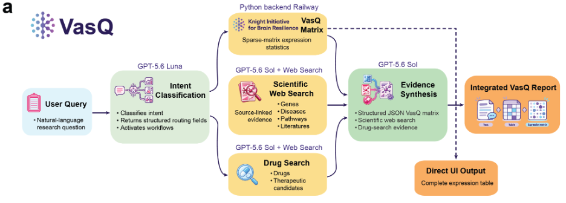

# 🧬 About VasQ

**VasQ** is a domain-specific AI chat system for exploring a human brain vascular single-nucleus RNA-seq atlas and generating biomedical hypotheses, particularly around blood-brain barrier (BBB) biology, regional vascular specialization, and drug delivery.

VasQ uses a hybrid GPT-5.6 architecture. GPT-5.6 Luna supports query classification and semantic entity resolution, while GPT-5.6 Sol supports scientific and therapeutic evidence retrieval and final response synthesis. The current workflow combines:

- **Human brain vascular snRNA-seq data**: Region-, cell-class–, and cell-type–resolved expression measurements across 41 brain regions, derived from approximately 443,000 nuclei and an HVG-filtered matrix of approximately 15,000 genes.
- **Deterministic atlas analysis**: Numerical summaries, tables, and plots are computed directly from the local expression matrix.
- **OpenAI Web Search**: Question-specific retrieval of scientific and therapeutic evidence from authoritative online sources, with inline source links.

## Key capabilities

- Natural-language expression queries with optional filters for brain region, region layer, cell class, cell type, and sex.
- Matrix-derived mean log-normalized expression, percentage of expressing cells, and number of cells analyzed; groups with fewer than 10 cells are not displayed.
- Hybrid rule-based and LLM-assisted intent classification and entity resolution, including aliases, abbreviations, and semantic dataset-label mapping.
- Scientific evidence retrieval for gene function, pathways, mechanisms, and disease associations.
- Drug and small-molecule retrieval when therapeutics are explicitly requested, using authoritative drug, trial, publication, and regulatory sources.
- Interactive Plotly visualizations and a paginated expression table with CSV download. For multi-gene queries, all eligible genes remain in the table and the top three expression profiles are plotted.
- Evidence-grounded final synthesis that combines matrix-derived quantitative results with retrieved scientific evidence.

The full cell-by-gene matrix, individual-cell records, and complete expression table are not sent to the language model. The model receives only a compact set of aggregate expression results for interpretation; the complete table and plots are generated separately by deterministic code.

VasQ is intended for atlas exploration and hypothesis generation, not clinical decision-making.

> ℹ️ A paper describing VasQ's design and capabilities is forthcoming.

---

# 🏗️ Architecture



The active VasQ application is implemented in `vasq/` using Django 4.2, django-ninja, WhiteNoise, and Plotly.js. OpenAI Chat Completions are used for classification and synthesis, while the OpenAI Responses API with Web Search is used for live scientific and drug-evidence retrieval.

**Current request flow:**

1. Classify the query and extract genes, diseases, and expression/drug intent.
2. For scientific questions, retrieve current evidence from authoritative online sources. An explicit VasQ-matrix-only request skips web retrieval.
3. For supported brain-expression questions, resolve dataset filters and calculate results directly from the VasQ matrix.
4. If drugs or therapeutics are explicitly requested, run a separate drug-focused search.
5. Synthesize the relevant evidence and return a text answer together with any expression plots and the full table.

The `kg_rag/` directory and precomputed marker-table files are retained as legacy components, but SPOKE/KG-RAG and Google Vertex AI Search are not used in the current VasQ response pipeline.

## Data files

The active expression workflow reads from `/data` inside the container (`DATA_DIR = "/data"` in [`functions.py`](vasq/vasq/functions.py)):

| File | Purpose |
|------|---------|
| `VasQ_adata_X_sparse.npz` | Sparse CSR log-normalized HVG expression matrix. |
| `VasQ_cell_meta_table.csv` | Per-nucleus metadata, including region, region layer, cell class, cell type, age at death, and sex. |
| `VasQ_gene_names.csv` | Gene symbols aligned to the matrix columns. |

Because the log-normalized expression matrix exceeds GitHub's file-size limits, the expression data files can be downloaded from [Figshare](https://figshare.com/projects/Atlas_of_Regional_Molecular_Specialization_in_the_Human_Brain_Vasculature/273930). During peer review, the files are accessible to reviewers through the private link provided and will be publicly released upon acceptance.

---

# 🧠 VasQ Setup Guide

## 🚀 Initial setup

**1. Install Docker Desktop**

[Download Docker Desktop for your operating system](https://docs.docker.com/desktop/) and start the application.

**2. Clone this repository**

```bash
git clone --branch railway-deploy https://github.com/congliu-design/VasQ.git
cd VasQ
```

Some legacy assets are tracked with Git LFS. If they are needed for development:

```bash
git lfs install
git lfs pull
```

**3. Download and add the expression data**

Download the expression data files from [Figshare](https://figshare.com/account/articles/33420964), then place the following files in `vasq/data/` so that Docker can mount them at `/data`:

- `VasQ_adata_X_sparse.npz`
- `VasQ_cell_meta_table.csv`
- `VasQ_gene_names.csv`

**4. Configure OpenAI**

Add your OpenAI API key and model settings to `.env-shared`:

```bash
OPENAI_API_KEY=your_openai_api_key
OPENAI_MODEL=gpt-5.6-sol
OPENAI_HELPER_MODEL=gpt-5.6-luna
OPENAI_WEB_MODEL=gpt-5.6-sol
OPENAI_MAIN_REASONING_EFFORT=high
OPENAI_HELPER_REASONING_EFFORT=none
OPENAI_WEB_REASONING_EFFORT=high
```

Model and reasoning settings can be changed through environment variables without editing the code.

## 🛠️ Run locally

Build and start the application with Docker Compose:

```bash
cd vasq
docker-compose build --no-cache
docker-compose up
```

The Django app is available at:

[http://127.0.0.1:8000/vasq/](http://127.0.0.1:8000/vasq/)

`docker-compose.yml` mounts `vasq/data/` to `/data`. The Compose file also starts the legacy KG-RAG container for backwards compatibility, but the current Django pipeline does not query it.

## ☁️ Deployment (Railway)

The public-facing Django service is built from `vasq/Dockerfile.railway` and served with gunicorn.

- Configure the deployment domain in [`vasq/newui/settings.py`](vasq/newui/settings.py).
- Provide the OpenAI variables shown above as Railway environment variables.
- Ensure the three active expression data files are available under `/data` in the deployed service.

---

# 🙏 Acknowledgements

VasQ was informed by the following open-source projects:

- [**scChat**](https://github.com/li-group/scChat), which provided an early reference for conversational single-cell data exploration.
- [**KG-RAG**](https://github.com/BaranziniLab/KG_RAG), whose SPOKE-based retrieval components remain in the repository as legacy code but are not part of the current VasQ workflow.

We are grateful to the developers of these projects for their contributions to the open-source community.
